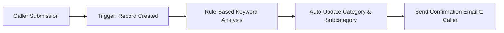
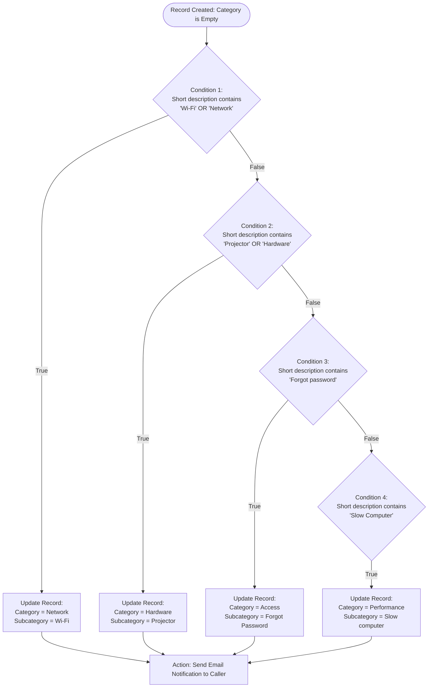

# Comprehensive Project Documentation

## Automated IT Ticket Classification & Notification System Using ServiceNow Flow Designer

---

## 📑 Table of Contents

1. [Executive Summary](#-executive-summary)
2. [Module 1: Requirement Analysis & Environment Setup](#1-module-1-requirement-analysis--environment-setup)
   - [1.1 Business Requirements](#11-business-requirements)
   - [1.2 Update Set Management & Navigation Steps](#12-update-set-management--navigation-steps)
3. [Module 2: Custom Table & Schema Development](#2-module-2-custom-table--schema-development)
   - [2.1 Custom Table Creation & Form Designer](#21-custom-table-creation--form-designer)
   - [2.2 Field Specifications & Choices Configuration](#22-field-specifications--choices-configuration)
   - [2.3 Dependent Field Configuration (Category ↔ Subcategory)](#23-dependent-field-configuration-category--subcategory)
4. [Module 3: Flow Designer Automation Engine](#3-module-3-flow-designer-automation-engine)
   - [3.1 Flow Definition & Trigger Configuration](#31-flow-definition--trigger-configuration)
   - [3.2 Conditional Classification Logic](#32-conditional-classification-logic)
   - [3.3 Automated Email Notification Action](#33-automated-email-notification-action)
   - [3.4 Flow Activation](#34-flow-activation)
5. [Module 4: Testing, Verification & Quality Assurance](#4-module-4-testing-verification--quality-assurance)
   - [4.1 Test Scenario 1: Wi-Fi / Network Issue](#41-test-scenario-1-wi-fi--network-issue)
   - [4.2 Email Notification Log Verification](#42-email-notification-log-verification)
   - [4.3 Test Scenario 2: Projector / Hardware Issue](#43-test-scenario-2-projector--hardware-issue)
   - [4.4 Additional Test Validations](#44-additional-test-validations)
6. [Module 5: Deployment & Packaging](#5-module-5-deployment--packaging)
   - [5.1 Finalizing & Closing the Update Set](#51-finalizing--closing-the-update-set)
   - [5.2 Exporting Update Set to XML](#52-exporting-update-set-to-xml)
   - [5.3 Migration & Distribution Procedures](#53-migration--distribution-procedures)
7. [Conclusion & Future Scope](#-conclusion--future-scope)

---

## 🔍 Executive Summary

In educational institutions and school IT departments, ticket intake is frequently hindered by manual triaging, incorrect categorization, and delayed acknowledgments to students and faculty.

This project delivers an automated, no-code/low-code service management solution built on the **ServiceNow** platform. By implementing a custom data model, dynamic choice dependencies, and a robust **Flow Designer** orchestration workflow, the system automatically analyzes inbound incident descriptions, assigns precise Category and Subcategory designations, and delivers instant confirmation notifications to the caller.



---

## 1. Module 1: Requirement Analysis & Environment Setup

### 1.1 Business Requirements

The implementation satisfies the following primary business criteria:

1. **Automatic Classification**: Classify incoming IT tickets dynamically based on keywords extracted from the ticket short description.
2. **Autonomous Multi-Field Assignment**: Simultaneously populate both `Category` and `Subcategory` without manual technician triage.
3. **Data Integrity via Choice Dependency**: Ensure that `Subcategory` options only display valid items corresponding to the selected `Category`.
4. **Immediate Stakeholder Notification**: Dispatch an automated confirmation email to the caller immediately upon ticket submission.
5. **Standardized Record Storage**: Store all ticket metadata in a dedicated, standardized table equipped with auto-numbering and auditing.
6. **Maintainability & Extensibility**: Deliver the solution using native ServiceNow low-code tools (Flow Designer) to facilitate effortless scalability and future maintenance.

### 1.2 Update Set Management & Navigation Steps

To adhere to ServiceNow ALM (Application Lifecycle Management) best practices and capture all schema, form, and flow modifications in a portable package, a dedicated Local Update Set is initiated.


#### Step-by-Step Navigation:

1. Navigate to **All** menus from the top application bar.
2. In the filter navigator, type `Update Sets`.
3. Under **System Update Sets**, click **Local Update Sets**.
4. In the list header, click the **New** button.
5. Populate the record fields:
   - **Name**: `Project Update Set`
   - **State**: `In progress`
   - **Application**: `Global`
6. Click the form header context menu or click **Submit / Save**.
7. In the **Related Links** section at the bottom of the form, click **Make This My Current Set**.
8. Verify that the system header reflects `Project Update Set` as the active update set.

> [!NOTE]
> Setting the update set as the current active set guarantees that all subsequent table creations, dictionary modifications, choice additions, and flows are automatically tracked.

---

## 2. Module 2: Custom Table & Schema Development

### 2.1 Custom Table Creation & Form Designer

A custom table (`School IT Ticket` / `Incident Workflow`) is configured to centralize ticket tracking. 

Key table properties:
- **Table Label**: `School IT Ticket`
- **Table Name**: `u_school_it_ticket` (or `Incident Workflow`)
- **Auto-Numbering**: Enabled with standard prefix (e.g., `TKT` or `INC`) and 7-digit numerical padding.
- **Form Layout**: Form Designer is used to organize fields into intuitive 2-column sections (Ticket Details, Classification, Assignment).


### 2.2 Field Specifications & Choices Configuration

The table schema incorporates mandatory operational attributes:

| Field Label | Backend Name (Typical) | Type | Reference Target / Choice Values | Description |
| :--- | :--- | :--- | :--- | :--- |
| **Number** | `u_number` | Auto Number | — | Unique sequential identifier |
| **Caller** | `u_caller` | Reference | `sys_user` | Requesting user / student |
| **Category** | `u_category` | Choice | `Network`, `Hardware`, `Access`, `Performance` | High-level categorization |
| **Subcategory** | `u_subcategory` | Choice | `Wi-Fi`, `Projector`, `Forgot Password`, `Slow computer` | Granular issue categorization |
| **Short Description** | `u_short_description` | String | Max length: 255 | Brief issue synopsis |
| **Description** | `u_description` | String | Max length: 4000 | In-depth troubleshooting notes |
| **State** | `u_state` | Choice | `New`, `In progress`, `On hold`, `Resolved`, `Closed` | Ticket processing status |
| **Assigned Group** | `u_assignment_group` | Reference | `sys_user_group` | Assigned support team |
| **Assigned to** | `u_assigned_to` | Reference | `sys_user` | Specific technician assigned |

#### Configuring Choice Fields:
1. Open the form and launch **Form Designer** (or **Configure Choices** via field context menu).
2. For **Category**, add choices:
   - `Network`
   - `Hardware`
   - `Access`
   - `Performance`
3. For **Subcategory**, add choices:
   - `Wi-Fi`
   - `Projector`
   - `Forgot Password`
   - `Slow computer`
4. For **State**, add choices:
   - `New` (Default value)
   - `In progress`
   - `On hold`
   - `Resolved`
   - `Closed`
5. Click **Save** in the top right corner and reload the form.

---

### 2.3 Dependent Field Configuration (Category ↔ Subcategory)

To maintain consistent data entry and eliminate invalid combinations, a parent-child dependency is enforced between `Category` and `Subcategory`.

#### Dependency Mapping:

| Selected Category | Available Subcategory Options |
| :--- | :--- |
| **Network** | `Wi-Fi` |
| **Hardware** | `Projector` |
| **Access** | `Forgot Password` |
| **Performance** | `Slow computer` |

#### Step-by-Step Configuration Steps:

1. Open the **School IT Ticket** form.
2. Right-click the **Subcategory** field label and select **Configure Dictionary**.
3. Under **Related Links**, select **Advanced view**.
4. Navigate to the **Dependent Field** tab/section.
5. Check the box: **Use dependent field** = `true`.
6. Set **Dependent on field** to `Category` (`u_category`).
7. Click **Update / Save**.
8. Scroll down to the **Choices** related list at the bottom of the Dictionary entry.
9. Edit each choice to specify the exact backend value of the parent category:
   - For choice **Wi-Fi** → set **Dependent value**: `Network`.
   - For choice **Projector** → set **Dependent value**: `Hardware`.
   - For choice **Forgot password** → set **Dependent value**: `Access`.
   - For choice **Slow computer** → set **Dependent value**: `Performance`.
10. Click **Save** and verify behavior on the form layout.

---

## 3. Module 3: Flow Designer Automation Engine

Flow Designer handles ticket analysis and caller notification using an automated trigger-action sequence.


### 3.1 Flow Definition & Trigger Configuration

#### Activity 1: Flow Creation
1. Navigate to **All** → search for `Flow Designer`.
2. Under **Process Automation**, click **Flow Designer**.
3. Click the **New** button in the top right corner and select **Flow**.
4. Configure Flow properties:
   - **Name**: `Auto Classify School IT Tickets`
   - **Application**: `Global`
   - **Run As**: System User (or User who initiates session)
5. Click **Build Flow**.

#### Activity 2: Trigger Configuration
1. Click **Add a Trigger** and select **Record Created**.
2. Configure trigger inputs:
   - **Table**: `Incident Workflow` (or `School IT Ticket`)
   - **Condition**: `Category` `is` `Empty`
3. Click **Done**.

---

### 3.2 Conditional Classification Logic

The flow utilizes sequential **If** and **Else If** evaluation branches that inspect the record's `Short Description` data pill:



#### Detailed Branch Configuration:

#### Activity 3: Wi-Fi Issue Classification (Branch 1)
- **Flow Logic**: Select **If**.
  - **Condition Label**: `SD is Wifi or Network`
  - **Condition 1**: `Short description` `contains` `Wi-Fi`
  - **Logical Operator**: `OR`
  - **Condition 2**: `Short description` `contains` `Network`
- **Action**: Select **Update Record**.
  - **Record**: Drag & drop `Incident Workflow Record` data pill from the Trigger on the right pane.
  - **Fields**:
    - `Category` = `Network`
    - `Subcategory` = `Wi-Fi`
- Click **Done**.

#### Activity 4: Projector Issue Classification (Branch 2)
- **Flow Logic**: Select **Else If**.
  - **Condition Label**: `SD is Projector or Hardware`
  - **Condition**: `Short description` `contains` `Projector` (or `Hardware`)
- **Action**: Select **Update Record**.
  - **Record**: `Trigger -> Incident Workflow Record`
  - **Fields**:
    - `Category` = `Hardware`
    - `Subcategory` = `Projector`
- Click **Done**.

#### Activity 5: Password Issue Classification (Branch 3)
- **Flow Logic**: Select **Else If**.
  - **Condition Label**: `SD is Forgot password`
  - **Condition**: `Short description` `contains` `Forgot password`
- **Action**: Select **Update Record**.
  - **Record**: `Trigger -> Incident Workflow Record`
  - **Fields**:
    - `Category` = `Access`
    - `Subcategory` = `Forgot Password`
- Click **Done**.

#### Activity 6: Slow Computer Classification (Branch 4)
- **Flow Logic**: Select **Else If**.
  - **Condition Label**: `SD is Performance`
  - **Condition**: `Short description` `contains` `Slow Computer`
- **Action**: Select **Update Record**.
  - **Record**: `Trigger -> Incident Workflow Record`
  - **Fields**:
    - `Category` = `Performance`
    - `Subcategory` = `Slow computer`
- Click **Done**.

---

### 3.3 Automated Email Notification Action

#### Activity 7: Email Action Setup
Following classification update, an immediate confirmation is dispatched to the user:

1. Click **Add an Action, Flow Logic, or Subflow** outside/after the conditional branches.
2. Select ServiceNow Core Action: **Send Email**.
3. Configure Action Inputs:
   - **Target Record**: `Trigger -> Incident Workflow Record`
   - **To**: Expand `Trigger -> Incident Workflow Record -> Caller` and select `Email` (`Trigger -> Record -> Caller -> Email`).
   - **Subject**: `Your Request for the issue has been submitted`
   - **Body**:
     ```html
     Dear Caller,

     Thank you for reaching out to the School IT Helpdesk.

     Your ticket regarding the issue has been successfully received and classified.
     Our technical support team has been notified and is currently reviewing your request.

     Best regards,
     School IT Support Services
     ```
4. Click **Done**.

---

### 3.4 Flow Activation

1. Review the flow layout and verify all data pills are accurately mapped.
2. Click **Save** in the top navigation header.
3. Click the **Activate** button in the top right corner.
4. Confirm the activation status dialog displays **Active**.

---

## 4. Module 4: Testing, Verification & Quality Assurance

Comprehensive testing was performed to validate keyword matching, field population, choice dependency rules, and email log delivery.


### 4.1 Test Scenario 1: Wi-Fi / Network Issue

| Attribute | Test Input / Action | Expected Result | Actual Result | Status |
| :--- | :--- | :--- | :--- | :---: |
| **Caller** | Active user record (e.g., student account) | Record selected | Selected | **PASS** |
| **Short Description** | `WiFi not working in library` | Text captured | `WiFi not working in library` | **PASS** |
| **Category (Initial)**| Left blank / Empty | Triggers Flow | Triggered | **PASS** |
| **Category (Post)** | Auto-populated | `Network` | `Network` | **PASS** |
| **Subcategory (Post)**| Auto-populated | `Wi-Fi` | `Wi-Fi` | **PASS** |
| **Email Dispatch** | Triggered on classification | Email record generated | Email created in queue | **PASS** |

#### Execution Procedure:
1. Open the **School IT Ticket** module and click **New**.
2. Select a valid **Caller**.
3. Enter `WiFi not working in library` into the **Short Description** field.
4. Click **Save** / **Submit**.
5. Reload the form record.
6. **Result**: Both `Category` (`Network`) and `Subcategory` (`Wi-Fi`) are populated automatically.

---

### 4.2 Email Notification Log Verification

ServiceNow stores all generated outbound notifications in the `sys_email` system table.

#### Verification Procedure:
1. Navigate to **All** → search for `Emails`.
2. Under **System Logs**, click **Emails**.
3. In the list search bar, filter by:
   - **Subject** `contains` `Your Request for the issue has been submitted`.
4. Locate the newly generated record matching the created ticket timestamp.
5. Open the email log record and scroll to **Related Links**.
6. Click **Preview Email**.
7. Confirm recipient address matches the Caller's email, subject line is intact, and body contains the confirmation message.

---

### 4.3 Test Scenario 2: Projector / Hardware Issue

| Attribute | Test Input / Action | Expected Result | Actual Result | Status |
| :--- | :--- | :--- | :--- | :---: |
| **Caller** | Active user record | Record selected | Selected | **PASS** |
| **Short Description** | `Projector not turning on in Lab 2` | Text captured | Entered | **PASS** |
| **Category (Post)** | Auto-populated | `Hardware` | `Hardware` | **PASS** |
| **Subcategory (Post)**| Auto-populated | `Projector` | `Projector` | **PASS** |
| **Email Dispatch** | Sent to caller email | Delivery logged | Logged | **PASS** |

#### Execution Procedure:
1. Create a new ticket with Short Description: `Projector not turning on`.
2. Save and reload the form.
3. Observe fields: `Category` = `Hardware`, `Subcategory` = `Projector`.
4. Re-verify the corresponding email in **System Logs** → **Emails**.

---

### 4.4 Additional Test Validations

- **Forgot Password Scenario**: Short description containing `Forgot password` successfully categorized into `Access` / `Forgot Password`.
- **Slow Computer Scenario**: Short description containing `Slow Computer` successfully categorized into `Performance` / `Slow computer`.
- **Dependent Choices Integrity**: Verified that changing Category to `Hardware` on the form restricts the Subcategory dropdown exclusively to `Projector`.

---

## 5. Module 5: Deployment & Packaging

To migrate the complete solution between instances (e.g., from Development to Sub-Production or Production), the Update Set is completed and exported as an XML package.


### 5.1 Finalizing & Closing the Update Set

1. Navigate to **All** → search for `Local Update Sets`.
2. Under **System Update Sets**, open **Local Update Sets**.
3. Locate and open `Project Update Set`.
4. Inspect the **Customer Updates** related list to verify all components are present:
   - Table definition
   - Dictionary entries and choices
   - Flow Designer objects and actions
5. Change the **State** field from `In progress` to `Complete`.
6. Click **Save** in the top form header.

> [!WARNING]
> Once an Update Set is moved to `Complete`, no further changes will be recorded in it. Ensure all configurations are final prior to closing.

---

### 5.2 Exporting Update Set to XML

1. On the completed `Project Update Set` form, navigate to **Related Links**.
2. Click **Export to XML**.
3. The system will compile and download a file named similarly to:
   ```text
   sys_remote_update_set_<sys_id>.xml
   ```
4. Store the downloaded XML file securely in version control or project archives.

---

### 5.3 Migration & Distribution Procedures

1. **Distribution**:
   - The XML export file can be shared directly via email, shared network storage, or administrative channels.
2. **Target Instance Import**:
   - In the target ServiceNow instance, navigate to **System Update Sets** → **Retrieved Update Sets**.
   - Click **Import Update Set from XML** and select the `.xml` file.
   - Open the retrieved set and click **Preview Update Set**.
   - Confirm there are zero collisions or missing prerequisites.
   - Click **Commit Update Set** to deploy all tables, forms, and flows.

---

## 💡 Conclusion & Future Scope

### Project Summary

The **Auto Ticket Classification using Flow Designer** project successfully delivers a complete, end-to-end automation solution for a school IT helpdesk. The primary objective of reducing manual effort in ticket categorization and improving response efficiency has been fully achieved.

Through structured requirement analysis, careful backend configuration, and no-code automation using Flow Designer, the system now automatically classifies IT tickets based on the short description provided by students. The implementation of dependent choice fields ensures data accuracy, while automated email notifications improve communication by instantly acknowledging ticket creation to the caller.

The solution was developed using a phased approach, ensuring clarity, stability, and ease of maintenance. Comprehensive testing and security validation confirmed that the system functions reliably, maintains data integrity, and enforces appropriate access controls.

Overall, this project demonstrates how ServiceNow can be effectively used to build scalable, maintainable, and user-friendly automation solutions without relying on complex scripting or machine learning. The design is well-suited for small to medium environments such as educational institutions and can be easily extended in the future to include advanced features like assignment automation, SLA tracking, or predictive intelligence.

---

### Future Enhancement Roadmap

1. **Automated Assignment Routing**: Extend Flow Designer to assign tickets directly to specific Assignment Groups (`sys_user_group`) based on the classified Category (e.g., Network tickets to `Network Support Team`).
2. **SLA Management**: Configure Service Level Agreements (SLAs) tailored to specific category priorities (e.g., critical network outages vs. password resets).
3. **Service Portal Catalog Integration**: Embed ticket submission into a responsive Service Portal widget with real-time category recommendations.
4. **Predictive Intelligence & NLP**: As ticket volume expands, incorporate ServiceNow Predictive Intelligence machine-learning models to analyze free-form incident descriptions beyond explicit keyword matching.
