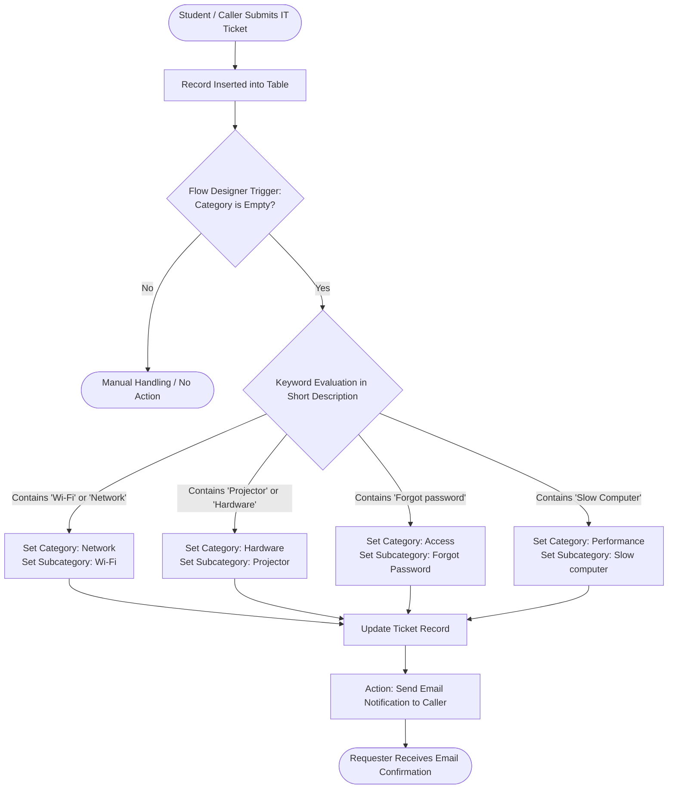

# Automated IT Ticket Classification & Notification System

> **ServiceNow Low-Code/No-Code ITSM Automation for Educational & Enterprise Helpdesks**

[](https://www.servicenow.com/)
[](https://docs.servicenow.com/)
[-green?style=for-the-badge)]()

---

## 📌 Project Overview

In academic and enterprise IT support environments, manual triage and classification of service requests introduce delays, routing errors, and inconsistent reporting. 

The **Automated IT Ticket Classification & Notification System** automates the end-to-end incident intake lifecycle within ServiceNow. By leveraging **Flow Designer** no-code logic, custom data modeling, dependent choice hierarchies, and automated notification triggers, tickets submitted by users are instantly analyzed, accurately categorized, and acknowledged via automated email—eliminating manual intervention for frontline IT agents.

---

## 🚀 Key Highlights & Features

- **Automated Issue Triage**: Intelligently inspects ticket `Short Description` text using keyword rules to determine Category and Subcategory.
- **Dynamic Dependent Choices**: Enforces field dependency between `Category` and `Subcategory` to maintain high data integrity.
- **Instant Caller Notifications**: Automatically delivers personalized confirmation emails to the ticket requester upon record creation.
- **Enterprise-Grade Packaging**: Developed cleanly within a scoped/global **Local Update Set** for seamless environment promotion (Dev → Test → Prod).
- **Scalable Architecture**: Built entirely using ServiceNow native configuration and Flow Designer without brittle hardcoded scripts.

---

## 🏗️ Solution Architecture & Workflow



---

## 📊 Data Dictionary & Schema

The custom table (`School IT Ticket` / `Incident Workflow`) stores ticket details with the following schema:

| Field Label | Field Type | Target / Choices | Description |
| :--- | :--- | :--- | :--- |
| **Number** | Auto Number | System generated prefix (e.g., `TKT0001`) | Unique ticket identifier |
| **Caller** | Reference | `sys_user` | User reporting the incident |
| **Category** | Choice | `Network`, `Hardware`, `Access`, `Performance` | High-level categorization |
| **Subcategory** | Choice (Dependent) | `Wi-Fi`, `Projector`, `Forgot Password`, `Slow computer` | Granular issue classification |
| **Short Description** | String (255) | User input | Brief summary analyzed by classifier |
| **Description** | String (4000) | User input | Detailed explanation of the issue |
| **State** | Choice | `New`, `In progress`, `On hold`, `Resolved`, `Closed` | Ticket lifecycle state |
| **Assigned Group** | Reference | `sys_user_group` | Assignment group for resolution |
| **Assigned to** | Reference | `sys_user` | Specific technician assigned |

### Dependent Choices Matrix

| Category Choice | Subcategory Choice |
| :--- | :--- |
| **Network** | Wi-Fi |
| **Hardware** | Projector |
| **Access** | Forgot Password |
| **Performance** | Slow computer |

---

## 📂 Project Structure & Milestones

The complete implementation is structured across 5 core milestones:

```text
├── README.md                                  # Executive summary & quick reference
├── PROJECT_DOCUMENTATION.md                   # Full step-by-step implementation guide
├── screenshot/
│   ├── Requirement Analysis & Planning module 1.png     # Module 1: Update Set & Planning
│   ├── Backend Development & Configuration module 2.png # Module 2: Schema & Form Design
│   ├── autoclassifier module 3.png                     # Module 3: Flow Designer Setup
│   ├── Testing, Validation & Security module 4.png      # Module 4: Test Cases & Email Logs
│   └── Deployment & conclusion model 5.png              # Module 5: Update Set Export & Close
```

| Milestone | Title | Objective |
| :---: | :--- | :--- |
| **01** | **Requirement Analysis & Planning** | Establish project boundaries and capture changes in a dedicated Local Update Set (`Project Update Set`). |
| **02** | **Backend Development & Form Design** | Construct custom ticket table, schema fields, choice sets, and configure dictionary dependent attributes. |
| **03** | **Flow Designer Automation** | Build `Auto Classify School IT Tickets` flow with multi-branch logic and email notification actions. |
| **04** | **Testing, Validation & Logs** | Execute end-to-end test scenarios (Wi-Fi, Projector, etc.) and verify outbound email logs in `sys_email`. |
| **05** | **Deployment & Release Management** | Transition update set to `Complete`, export XML package, and prepare release artifact for migration. |

---

## 📸 Implementation Highlights

### 1. Requirement Analysis & Update Set Management
Tracking all configurations within an isolated update set ensures clean deployment across environments without missing artifacts.


### 2. Backend Table & Dependent Choices Setup
Configuring dictionary attributes ensures that users only select subcategories relevant to the assigned category.


### 3. Automated Flow Designer Workflow
Low-code condition routing inspects caller input and updates records instantaneously on insert.


### 4. Testing & Email Verification
Outbound email logs validate delivery of ticket submission acknowledgments directly to the caller.


### 5. Deployment Packaging
Closing and exporting the update set as XML allows transport via standard DevOps or manual administrative channels.


---

## 🛠️ Quick Deployment Guide

To deploy this solution into a target ServiceNow instance:

1. **Import Update Set XML**:
   - Navigate to **System Update Sets** → **Retrieved Update Sets**.
   - Click **Import Update Set from XML**.
   - Upload the exported XML file.
2. **Preview & Commit**:
   - Open the retrieved update set record.
   - Click **Preview Update Set** to verify conflicts (resolve if any).
   - Click **Commit Update Set**.
3. **Verify Activation**:
   - Ensure the flow `Auto Classify School IT Tickets` is marked **Active** under **Process Automation** → **Flow Designer**.
   - Submit a test ticket with short description `Wi-Fi connection failed` to verify classification.

---

## 📖 Detailed Documentation

For exhaustive step-by-step instructions, complete navigation paths, form designer layouts, dictionary settings, and test cases, refer to the full [Project Documentation](file:///h:/NM/PROJECT_DOCUMENTATION.md).

---

## 📄 License & Attribution

Designed and implemented for ServiceNow IT Service Management (ITSM) automation. Built using standard ServiceNow Low-Code platform capabilities.
